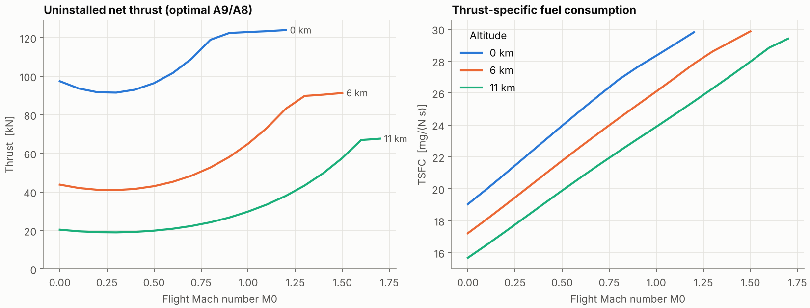
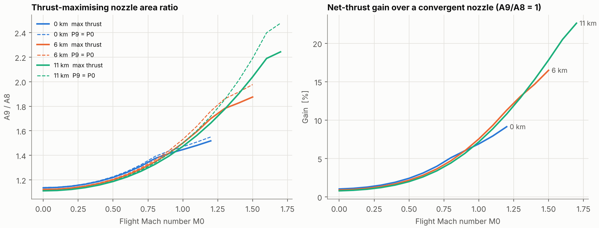
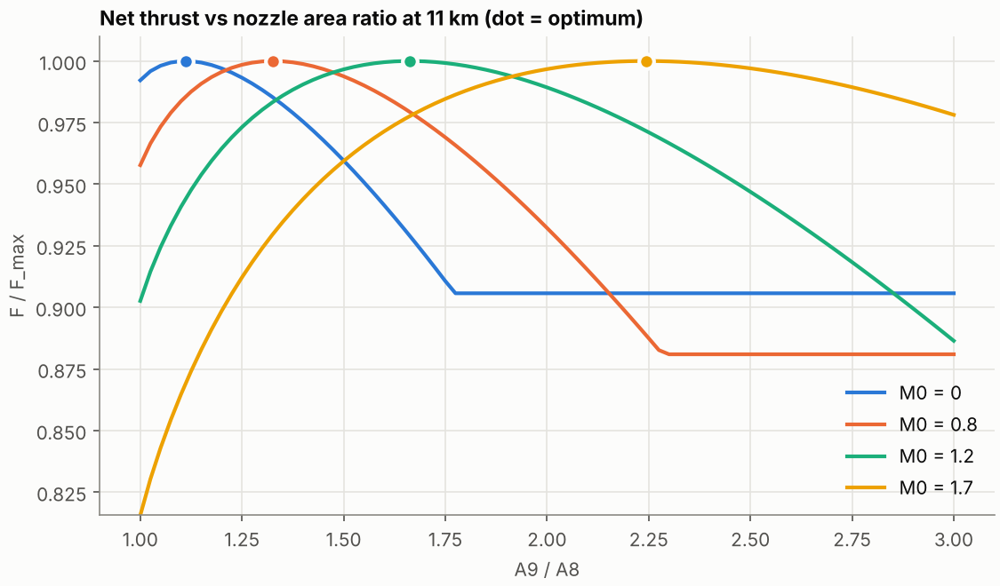
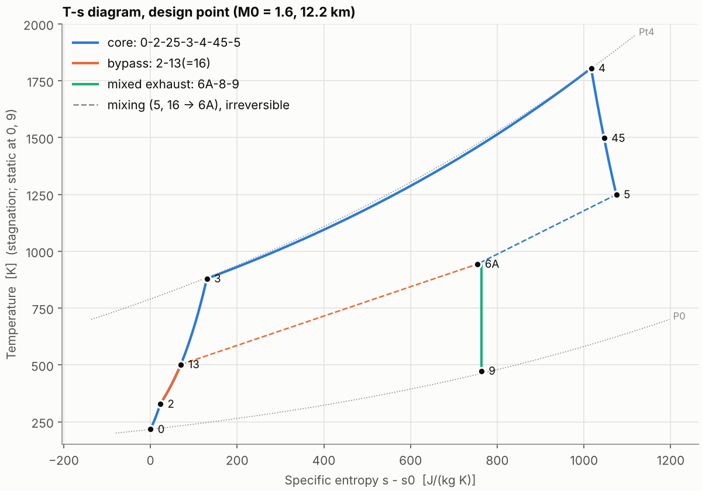
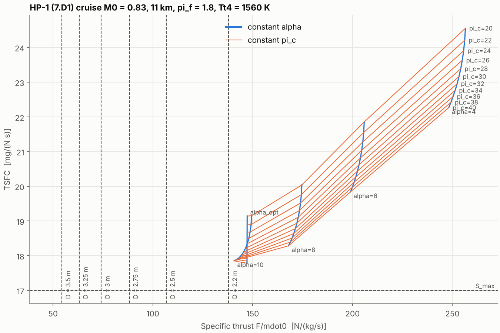
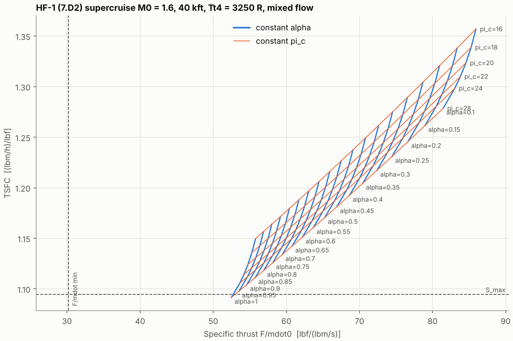

# Two-spool, mixed-flow, medium-bypass turbofan: cycle analysis

A Python package that models a two-spool, mixed-flow turbofan from Mach 0 to 1.7:

* **Station-by-station cycle analysis** with **temperature- and fuel/air-dependent cp** (thermally perfect gas). Component efficiencies and losses are inputs.
* **Design point (sizing)** and **off-design operation** of the fixed-geometry engine, following Mattingly's ch. 8 assumptions with real-gas properties.
* A **variable convergent-divergent nozzle**. The exit-to-throat area ratio A9/A8 is swept to find the **thrust-maximising area at every flight condition**.
* **Closed-form "PARA" equations** (Mattingly, *Elements of Propulsion*, ch. 7) for design problems **7.D1** (HP-1, separate-flow) and **7.D2** (HF-1, mixed-flow), with hand calculations, sweeps and carpet plots.
* pytest tests, including one that reproduces the textbook mixed-flow cycle to round-off with the general solver.

Every equation in the source has a comment that says where it comes from and why it holds.

```
pip install -e ".[test]"
pytest                                   # 32 tests, ~2 s
python scripts/run_engine_study.py       # design + Mach sweep + nozzle optimisation -> figures/
python scripts/hp1_design_problem.py     # 7.D1 hand calc, sweep, min specific thrust, carpet plot
python scripts/hf1_design_problem.py     # 7.D2 likewise
```

## Engine and station numbering

```
         ┌──────── bypass duct 13 ─────────── 16 ┐
 0 ─ 2 ─ FAN ┤                                   MIXER ─ 6A ─ 8 (throat) ─ 9 (exit)
   inlet     └ 25 ─ HPC ─ 3 ─ BURNER ─ 4 ─ HPT ─ 45 ─ LPT ─ 5=6 ┘          C-D nozzle
             LP spool: fan ◄──────────────────────────── LPT
             HP spool:        HPC ◄──────────── HPT
```

| Module | What it contains |
|---|---|
| `gas.py` | `ThermallyPerfectGas`: Walsh & Fletcher cp(T, FAR) polynomials for air and kerosene products, h(T), entropy function φ(T). `TwoGammaGas`: Mattingly's constant-property model behind the same interface. |
| `flow.py` | Isentropic relations, sonic and choked states, and mass-flux inversion for a variable-cp gas. Each one is a 1-D root-find in static T built from energy, the isentrope and the equation of state. |
| `components.py` | Inlet recovery (MIL-E-5008B), polytropic compression and expansion, burner first law, the choked-turbine pressure ratio, and a constant-area mixer from mass, energy and momentum conservation. |
| `nozzle.py` | C-D nozzle with total-pressure loss, conical divergence loss and Summerfield separation, plus the A9/A8 sweep and optimiser. |
| `engine.py` | `design()` runs the parametric cycle and sizes A4, A45, A6, A16 and A8. `Engine.operate()` solves the off-design match with a throttle-ratio Tt4 schedule. |
| `parametric.py` | Mattingly ch. 7 closed-form equations for a separate-flow turbofan with losses (and its optimum α), and a mixed-flow turbofan with losses (the Problem 7.27 system). |
| `aircraft.py` | Required thrust (Eq. 1.28 energy method, drag polar), inlet capture flow and minimum specific thrust. |
| `plots.py`, `sweeps.py` | Figures and the flight-envelope sweep. |

## Key equations (one-line versions you can defend)

* **Real-gas isentrope.** From T ds = dh − dp/ρ with cp = cp(T): s₂ − s₁ = φ(T₂) − φ(T₁) − R ln(p₂/p₁), where φ = ∫cp/T dT. An isentrope is therefore φ(T₂) − φ(T₁) = R ln(p₂/p₁). With constant cp this becomes T₂/T₁ = (p₂/p₁)^((γ−1)/γ).
* **Polytropic efficiency.** Every infinitesimal stage has efficiency e:
  * compression: φ(Tt,out) − φ(Tt,in) = (R/e) ln π
  * expansion: φ(Tt,out) − φ(Tt,in) = e R ln π

  With constant cp this is τ = π^((γ−1)/(γe)).
* **Burner.** h(Tt3, air) + f η_b h_PR = (1+f) h(Tt4, products), with enthalpies measured from 298 K (where h_PR is defined). It is iterated because the product cp depends on f.
* **Spool power balances.** HP: ṁ_core (h3 − h25) = η_mH ṁ4 (h4 − h45). LP: ṁ0 (h13 − h2) = η_mL ṁ45 (h45 − h5).
* **Mixer.** Conserves mass, energy and the impulse function P·A + ṁV across a constant-area duct. The ideal mixing loss comes out of the momentum balance; wall friction is π_M,max. At design the streams match Pt16 = Pt6 (Mattingly), which fixes π_f for a given π_c and α.
* **Choked throats.** ṁ = A·(ρV)*(Tt, Pt). A turbine between two choked throats runs at a fixed π_t (`choked_turbine_pressure_ratio`).
* **Nozzle optimum.** F_g = ṁV₉ + (P₉ − P₀)A₉. Along the isentrope d(ṁV) = −A dP, so dF_g/dA₉ = P₉ − P₀ and the lossless optimum is P₉ = P₀.

## Off-design model

Held fixed off-design:
* component polytropic efficiencies
* the HPT and LPT nozzle-guide-vane throats (choked)
* the mixer inlet areas, with P16 = P6 at the splitter
* the nozzle throat A8

The unknowns are (π_f, α) and the residuals are (P16 − P6, nozzle flow mismatch). Everything else follows station by station.

Tt4 follows Mattingly's **throttle ratio** law: TR = θ0 at design (here 1.138), and Tt4 = Tt4,max · min(1, θ0/TR). Below the θ-break the engine runs at nearly constant corrected conditions. Above it, Tt4 is capped, so the compressors unload and α rises. That is the kink in the thrust curves.

Default design point (`DesignInputs()`):
* M0 = 1.6 at 40 kft, ṁ0 = 100 kg/s
* α = 0.8, π_c = 25, Tt4 = 1805 K (3250 °R)
* level-4 technology: e_f 0.89, e_cH 0.90, e_t 0.89, π_b 0.96, η_b 0.999, π_d,max 0.96 (type C), π_n 0.97 (type F), π_M,max 0.96, M6 = 0.4

| Design result | Value |
|---|---|
| π_f (from Pt16 = Pt6) | 3.82 |
| π_cH | 6.54 |
| f | 0.0288 |
| F/ṁ0 | 553 N/(kg/s) |
| TSFC | 28.9 mg/(N·s) |
| A9/A8 for P9 = P0 | 2.40 |

## Results

### Thrust and TSFC vs Mach (optimal A9/A8 at each point)


### Thrust-maximising nozzle area schedule


The full table is in `figures/optimal_area_schedule.csv`. Selected points:

| alt | M0 | A9/A8 opt | A9/A8 (P9=P0) | gain vs convergent |
|---|---|---|---|---|
| 0 km | 0.0 | 1.135 | 1.138 | 1.0 % |
| 0 km | 1.2 | 1.518 | 1.550 | 9.1 % |
| 11 km | 0.8 | 1.326 | 1.339 | 4.4 % |
| 11 km | 1.2 | 1.663 | 1.718 | 10.8 % |
| 11 km | 1.6 | 2.189 | 2.399 | 20.5 % |
| 11 km | 1.7 | 2.243 | 2.477 | 22.6 % |

What to say about it:
1. The optimum tracks ideal expansion, because dF/dA9 = P9 − P0.
2. It sits slightly **below** the P9 = P0 area, so the nozzle is slightly under-expanded. A fixed-length flap opens to a larger half-angle as A9 grows, and the divergence loss (1 + cos θ)/2 grows with it. Near the optimum the curve is flat, so a little pressure thrust is a cheap trade for less angularity.
3. The payoff from the divergent section grows with nozzle pressure ratio: about 1 % at static conditions and over 20 % at M 1.7.



The flat tails at large A9/A8 come from the separation model. Once the wall pressure falls below 0.37·P0 the jet separates, so the over-expansion penalty stops growing.

### T-s diagram at the design point


## Textbook problems 7.D1 and 7.D2

### 7.D1 (HP-1, separate flow)

Inputs: M0 0.83, 11 km, Tt4 1560 K, π_c 36, π_f 1.8, α 10; level 4 with type A diffuser, type D nozzle and cooled turbine.

| Hand calculation | Value |
|---|---|
| τ_r | 1.1378 |
| τ_λ | 8.857 |
| τ_c | 3.1194 |
| τ_f | 1.2077 |
| f | 0.02828 |
| τ_t | 0.4705 |
| **F/ṁ0** | **143.25 N/(kg/s)** |
| **S** | **17.95 mg/(N·s)** |

At π_f = 1.8 the TSFC-optimal α is about 9.6–10.2 across π_c = 20–40. At that α the specific thrust is almost constant (about 147 N/(kg/s)), because the optimum is where the core and fan jet velocities nearly match.



### 7.D2 (HF-1, mixed flow)

Inputs: M0 1.6, 40 kft, Tt4 3250 °R, π_c 25, α 0.5, M6 0.4, π_M,max 0.96; level 4 with type C diffuser, type F nozzle and cooled turbine. π_f comes from the Problem 7.27 system (Pt16 = Pt6).

| Hand calculation | Value |
|---|---|
| τ_r | 1.512 |
| η_r | 0.9624 |
| τ_λ | 10.278 |
| τ_c | 2.7784 |
| f | 0.03265 |
| **π_f** | **4.268** |
| τ_t | 0.7014 |
| M16 | 0.386 |
| M6A | 0.417 |
| π_M | 0.953 |
| **F/ṁ0** | **66.27 lbf/(lbm/s)** |
| **S** | **1.1826 (lbm/h)/lbf** |



> **Before using these for coursework:**
> 1. **Check the numbers against your book.** The Table 6.2 level-4 values are in `turbofan/tech_levels.py` and were transcribed from memory. The hand-calc numbers above come from this code; they have not been compared with the PARA printouts or the solution manual. If your copy of Table 6.2 differs, edit `tech_levels.py`; the tests will show which expected values move.
> 2. **Replace the aircraft data.** The HP-1 and HF-1 weights, drag polars and S_max values in `turbofan/aircraft.py` are **placeholders** of the right magnitude. Use your Chapter 1/2 values (`--weight`, `--wing-area`, `--cd0`, `--k1`, `--k2`, `--smax` on the scripts) before drawing conclusions from the dashed lines on the carpet plots.
> 3. **The fan pressure ratio is "your assigned value".** For 7.D1 pass it with `--pi-f` (default 1.8).

## How the tests establish correctness

* **Textbook reproduction** (`test_textbook_problems.py`).
  * Each 7.D1 and 7.D2 hand-calc step is checked against the problem data (τ_r, π_r, η_r, τ_λ, τ_c, f, the power balance).
  * The Pt16 = Pt6 condition and the mixed-gas properties are verified.
  * The general station-by-station solver, run with Mattingly's two-gamma gas, matches the closed-form mixed-flow equations to about 1e-12 on π_f, f, π_t, A16/A6, M6A, π_M, M9, F/ṁ0 and S.
  * One modelling difference is switched off for this comparison. Mattingly compresses all core air at e_c, while our two-spool model sends it through the fan (e_f) and then the HPC (e_c). The test sets e_f = e_c.
* **Conservation** (`test_engine.py`): both spool power balances, the burner first law, and mass, energy and momentum through the mixer, all to round-off.
* **Off-design.** The design point is reproduced exactly. Two flight conditions with the same Tt0 give identical pressure ratios and corrected flow (dimensional consistency). Above the θ-break the engine unloads as expected.
* **Gas and flow** (`test_gas_and_flow.py`, `test_nozzle.py`):
  * cp(300 K) and cp(1000 K) match air tables.
  * φ equals ∫cp/T dT numerically.
  * With constant γ, the sonic ratios and A/A*(M=2) = 1.6875 match isentropic tables.
  * Numerically, dF_g/dA9 = P9 − P0.
  * The lossless optimum is P9 = P0, and divergence loss moves it to under-expansion.
  * Separation limits the over-expansion penalty, and an unchoked nozzle exits at P0.

## Modelling limitations (be ready for these questions)

* There are no component maps. Polytropic efficiencies are held constant off-design (Mattingly ch. 8 assumption), and the fan has a single pressure ratio for the hub and the tip.
* There is no turbine cooling bleed or customer bleed/power extraction. The "cooled turbine" only selects e_t from Table 6.2.
* Dissociation is ignored. The polynomials are fitted to 200–2000 K, and R is held at the air value (kerosene products differ from it by less than 1 %).
* Inside the nozzle, the shock-in-divergent-section regime is approximated by the attached isentropic solution plus the separation criterion. The pressure-thrust term then carries the over-expansion penalty.
* There is no afterburner, no installation drag (spillage, boat-tail) and no inlet/engine flow matching. Sea-level points stop at M 1.2 and 6 km points at M 1.5 (dynamic-pressure limits).
